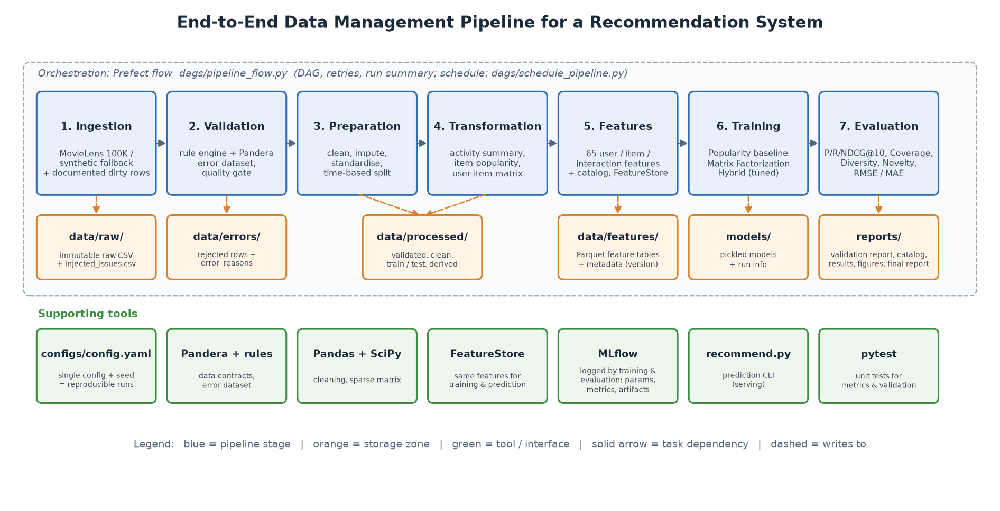

# End-to-End Data Management Pipeline for a Recommendation System

DM4ML Assignment 2: a modular, reproducible pipeline that recommends movies (MovieLens 100K) and covers
**ingestion → validation → preparation → transformation → feature management → training → evaluation → orchestration**.



---

## 1. What the pipeline does

| # | Stage | Module | Main outputs |
|---|---|---|---|
| 1 | **Ingestion** | `src/ingestion/ingest.py` | Downloads **MovieLens 100K** (943 users, 1,682 movies, 100k timestamped ratings). If the download fails, generates documented synthetic data in the same format. Injects a documented set of dirty records to exercise validation. Writes `data/raw/*.csv` and `data/raw/injected_issues.csv`. |
| 2 | **Validation** | `src/validation/` | 20 automated rules (missing values, data types, rating range, timestamps, duplicates, referential integrity) plus Pandera schemas. Valid rows go to `data/processed/*_validated`, invalid rows to `data/errors/*_errors.csv` with reasons. Writes `reports/validation_report.md`. A quality gate stops the run if more than 5% of interactions are invalid. |
| 3 | **Preparation** | `src/preparation/prepare.py` | Standardises formats, imputes missing values, removes repeated ratings, and makes a **time-based train/test split** (80/20). Writes `split_metadata.json`. |
| 4 | **Transformation** | `src/transformation/transform.py` | User activity summary, item popularity (with Bayesian average), item-genre matrix, sparse user-item matrix (`.npz`). |
| 5 | **Feature management** | `src/features/` | 65 documented user, item and interaction features. Stored as Parquet in `data/features/`, versioned in `feature_metadata.json`, served by `FeatureStore` to **both training and prediction**. Catalog in `reports/feature_catalog.md`. |
| 6 | **Training** | `src/training/` | **Popularity baseline**, **Matrix Factorization** (biased SVD with SGD) and a **Hybrid** (MF + genre content + popularity; weights tuned on a validation split taken from train). Logged to **MLflow**. |
| 7 | **Evaluation** | `src/evaluation/` | Precision@10, Recall@10, NDCG@10, HitRate@10, Coverage, Diversity, Novelty, RMSE, MAE, plus cold-start results. Writes `reports/model_comparison.md` and `reports/figures/model_comparison.png`. |
| 8 | **Orchestration** | `dags/pipeline_flow.py` | A **Prefect** flow (DAG of 10 tasks, retries, run summary). `dags/schedule_pipeline.py` schedules it daily. |
| – | Report | `src/reporting/` | Architecture diagram plus the 2–3 page final report (`reports/final_report.html`, which you print to PDF). |

---

## 2. Setup (one time)

Requires **Python 3.10, 3.11 or 3.12**.

### Windows (PowerShell or Command Prompt)
```bash
cd recommendation-pipeline
python -m venv .venv
.venv\Scripts\activate
python -m pip install --upgrade pip
pip install -r requirements.txt
```

### macOS / Linux
```bash
cd recommendation-pipeline
python3 -m venv .venv
source .venv/bin/activate
python -m pip install --upgrade pip
pip install -r requirements.txt
```

### Conda (alternative)
```bash
conda create -n recsys python=3.11 -y
conda activate recsys
pip install -r requirements.txt
```

---

## 3. Run the pipeline

### 3.1 Run everything with one command
```bash
python run_pipeline.py
```
This runs all 10 tasks in order. It takes about 1–2 minutes, and the first run also downloads MovieLens (about 5 MB).
Expect to see `Pipeline SUCCESS` at the end. Every number in the reports comes from this run.

### 3.2 See the run in the Prefect UI (for the "successful run" screenshot)
Terminal 1: start the Prefect server and leave it running.
```bash
prefect server start
```
Terminal 2: point the client at that server, then run the flow.
```bash
prefect config set PREFECT_API_URL=http://127.0.0.1:4200/api
python run_pipeline.py
```
Open **http://127.0.0.1:4200**, go to **Runs**, and open `recommendation-pipeline`. Screenshot the **task graph / timeline**
with every task *Completed*, and save it as `reports/figures/prefect_successful_run.png`.

### 3.3 View experiments in MLflow
```bash
mlflow ui --backend-store-uri sqlite:///mlflow.db
```
Open **http://127.0.0.1:5000** and go to the experiment `dm4ml-recommendation-pipeline`. There is one run per model, with
parameters, training metrics, test metrics (`test_*`), tags (data source, feature version, train cutoff) and the model file
as an artifact. Select the three runs and click **Compare** for a screenshot.

### 3.4 Get recommendations for a user (the prediction step reuses the same feature store)
```bash
python recommend.py --user 42
python recommend.py --user 42 --model matrix_factorization --k 5
```

### 3.5 Run a single stage, the tests, or the scheduled version
```bash
python run_pipeline.py --stage validate      # stages: ingest validate prepare transform features train evaluate report
pytest                                       # unit tests for the metrics, validation rules and time split
python dags/schedule_pipeline.py             # daily 02:00 schedule (needs the Prefect server from 3.2)
```

---

## 4. Where to find each deliverable

| Deliverable | Location |
|---|---|
| Source code (modules) | `src/`, `dags/`, `run_pipeline.py`, `recommend.py` |
| Setup and run instructions | this README |
| Dependencies | `requirements.txt` |
| Architecture diagram | `reports/figures/architecture_diagram.png` |
| Data validation report and logs | `reports/validation_report.md`, `reports/validation_checks.csv`, `data/errors/`, `logs/pipeline.log` |
| Feature catalog (table) | `reports/feature_catalog.md` (+ `.csv`) |
| Model comparison | `reports/model_comparison.md` (+ `.csv`), `reports/figures/model_comparison.png` |
| Orchestration DAG | `dags/pipeline_flow.py` (+ `dags/schedule_pipeline.py`) |
| Successful-run evidence | `reports/pipeline_run_summary.json` + your Prefect UI screenshot |
| Final report (2–3 pages) | `reports/final_report.html` → open it in Chrome → Ctrl+P → Save as PDF |

---

## 5. Project structure
```
recommendation-pipeline/
├── configs/config.yaml          # every parameter + seed (single source of truth)
├── dags/
│   ├── pipeline_flow.py         # Prefect flow (DAG) - falls back to plain Python if Prefect is absent
│   └── schedule_pipeline.py     # daily cron deployment
├── data/
│   ├── raw/                     # immutable raw copy + injected_issues.csv
│   ├── processed/               # validated, clean, train/test, derived datasets
│   ├── features/                # feature tables + feature_metadata.json
│   └── errors/                  # rejected records with error_reasons
├── models/                      # pickled models + <model>_run.json (MLflow run ids)
├── reports/                     # validation report, feature catalog, results, final report, figures/
├── src/
│   ├── ingestion/   validation/   preparation/   transformation/
│   ├── features/    training/     evaluation/    reporting/   utils/
├── tests/                       # pytest unit tests
├── run_pipeline.py              # single entry point
├── recommend.py                 # prediction CLI
├── requirements.txt
└── README.md
```

---

## 6. Design notes
* **Reproducibility:** one config file and fixed seeds. Each stage reads the previous stage's files, so any stage can be re-run on its own.
* **No data leakage:** the split is time-based, and every derived dataset and feature is computed from training data only, as of the
  train cutoff. The hybrid model's weights are tuned on the last 10% of the training period; the test set is never used for tuning.
* **Robustness:** without internet the pipeline uses synthetic data; without `pyarrow` it stores CSV; without MLflow it logs JSON to
  `reports/tracking/`; without Prefect `dags/pipeline_flow.py` runs as a plain, dependency-ordered workflow.
* **Configuration:** set `ingestion.inject_dirty_records: false` in `configs/config.yaml` to run on clean data only.

## 7. Troubleshooting
| Problem | Fix |
|---|---|
| `ModuleNotFoundError: src` | Run commands from the `recommendation-pipeline/` folder. |
| MovieLens download blocked | The pipeline falls back to synthetic data automatically. Alternatively, download `ml-100k.zip` manually from grouplens.org and unzip it into `data/raw/ml-100k/`. |
| Prefect run not visible in the UI | Start `prefect server start` first and set `PREFECT_API_URL` (section 3.2). |
| Port 4200 / 5000 already in use | `prefect server start --port 4300` / `mlflow ui --port 5001 ...` |
| Want a fresh start | Delete `data/*/*`, `models/*`, `mlflow.db`, `mlruns/`, then run again. |
