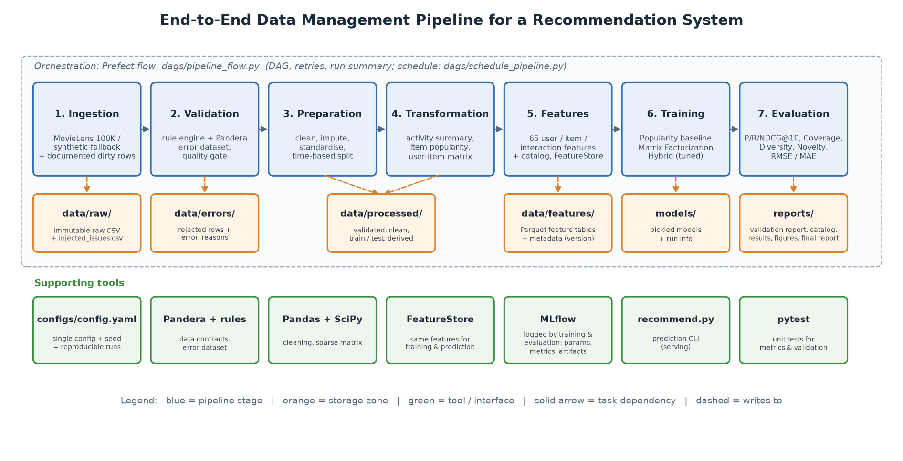
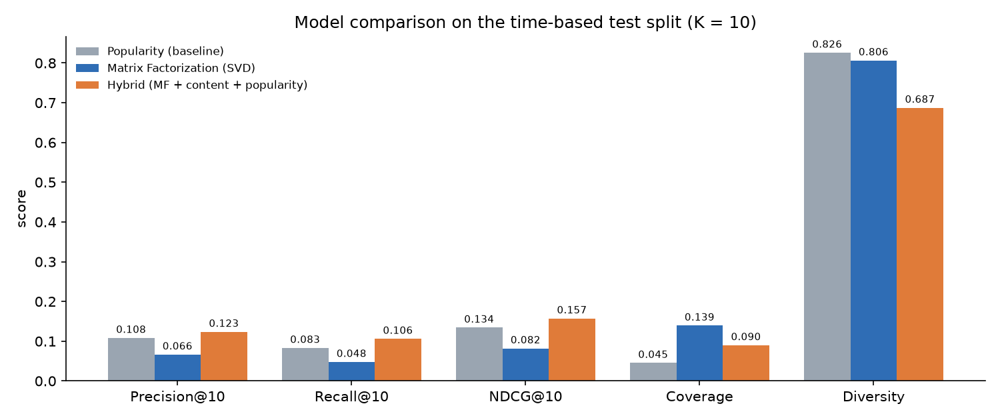

# End-to-End Data Management Pipeline for a Recommendation System
*Data Management for Machine Learning - Assignment 2 - final report (auto-generated 2026-11-14 00:34)*

## 1. Objective and data
We built a modular, reproducible pipeline that ingests user, item and interaction data, validates and prepares it,
engineers reusable features, trains and evaluates recommenders, and runs end-to-end as an orchestrated DAG.
**Data source:** movielens (MovieLens 100K format: users with age/gender/occupation, movies with release date and 19 genre
flags, and explicit 1-5 ratings with timestamps). Raw input: 949 user rows, 1,686 item rows and
100,024 interactions, including **45 documented, deliberately injected data-quality
issues** (`data/raw/injected_issues.csv`) that exercise every validation rule.

## 2. Design decisions and tools
| Stage | Implementation | Why |
|---|---|---|
| Ingestion | `src/ingestion` - download MovieLens 100K, synthetic MovieLens-format fallback, raw zone kept as text | immutable raw copy; pipeline runs even offline |
| Validation | `src/validation` - rule engine (20 checks: missing, type, range, duplicate, timestamp, referential) + Pandera schemas | invalid rows are separated into `data/errors/` with reasons; quality gate stops the run if > 5% of interactions are invalid |
| Preparation | `src/preparation` - standardise, impute optional fields, de-duplicate, **global time-based split** (80%/20%) | mimics production (train on past, test on future); no look-ahead leakage |
| Transformation | `src/transformation` - user activity summary, item popularity (Bayesian average), sparse user-item matrix | derived datasets from TRAIN only |
| Features | `src/features` - registry -> 65 documented features, Parquet tables, `FeatureStore` class, catalog | one definition reused by training *and* prediction (`recommend.py`), versioned (v1.0.0, as-of 1998-03-07 02:21:09) |
| Training | `src/training` - Popularity, biased Matrix Factorization (SGD), Hybrid; MLflow tracking | baseline + collaborative + hybrid; params, metrics, artifacts and lineage tags logged |
| Evaluation | `src/evaluation` - Precision/Recall/NDCG/HitRate@10, Coverage, Diversity, Novelty, RMSE/MAE | accuracy and beyond-accuracy; cold-start users reported separately |
| Orchestration | `dags/pipeline_flow.py` - Prefect flow, 10 tasks, retries on ingestion, run summary; cron deployment | one command reproduces everything from `configs/config.yaml` (seed 42) |

## 3. Data validation and preparation results
| Table | Raw | Valid | Rejected |
|---|---:|---:|---:|
| users | 949 | 943 | 6 |
| items | 1,686 | 1,682 | 4 |
| interactions | 100,024 | 100,000 | 24 |

18 of 20 rules detected problems (failed rows by category: duplicate: 12, missing: 6, range: 8, referential: 6, timestamp: 4, type: 4).
All 34 rejected records are stored with their failed rules in `data/errors/all_errors.csv`; details are in
`reports/validation_report.md`. Preparation imputed 5 missing occupations and
4 missing release dates and removed 0 repeated ratings.
The time split at **1998-03-07 02:21:09** gives 80,003 training and 19,997 test interactions;
192 test users have no training history (cold start). The user-item matrix is
943 x 1682 with density 5.04%.

## 4. Models
1. **Popularity baseline** - ranks unseen items by training popularity; predicts ratings with the Bayesian item average.
2. **Matrix Factorization** - r(u,i) = mu + b_u + b_i + p_u . q_i, 40 factors, 30 SGD epochs,
   learning rate 0.01, L2 0.05; items with < 5 training ratings are not recommended.
3. **Hybrid** - z(MF score) + w_content x z(cosine(user genre profile, item genres)) + w_pop x z(log popularity). Weights were
   grid-searched on the last 10% of the *training* period (test never used):
   **w_content = 0.5, w_pop = 2.0** (validation NDCG@10 = 0.148).

## 5. Results
Time-based test split; K = 10; relevant = test rating >= 4. Ranking metrics averaged over **98 warm users** (users with training history and at least one relevant test item). 192 cold-start users are served by the popularity fallback (column *Cold NDCG*).

| Model | Precision@10 | Recall@10 | NDCG@10 | HitRate@10 | Coverage | Diversity | Novelty | RMSE | MAE | Cold NDCG@10 |
|---|---:|---:|---:|---:|---:|---:|---:|---:|---:|---:|
| Popularity (baseline) | 0.1082 | 0.0830 | 0.1341 | 0.4592 | 0.0452 | 0.8258 | 1.58 | 1.0292 | 0.8296 | 0.3153 |
| Matrix Factorization (SVD) | 0.0663 | 0.0476 | 0.0818 | 0.2959 | 0.1391 | 0.8064 | 3.34 | 1.0232 | 0.8201 | 0.3153 |
| Hybrid (MF + content + popularity) | 0.1235 | 0.1058 | 0.1572 | 0.4898 | 0.0898 | 0.6873 | 2.09 | n/a | n/a | 0.3153 |

*Coverage* = share of the catalogue recommended to at least one user; *Diversity* = mean pairwise genre dissimilarity (1 - Jaccard) within a top-K list; *Novelty* = mean -log2(share of users who rated the item). RMSE/MAE are computed on all test ratings for models that predict explicit ratings (popularity predicts the Bayesian item average); the hybrid model is ranking-only.

* **Ranking quality.** The best model by NDCG@10 is **the hybrid model** (NDCG@10 = 0.1572). The hybrid model changes NDCG@10 by +17.2% and Precision@10 by +14.2% relative to the popularity baseline.
* **Matrix factorization alone ranks poorly** (NDCG@10 = 0.0818) although it is the most accurate rating predictor (RMSE 1.0232 vs 1.0292 for the baseline). Minimising squared rating error does not optimise top-K ranking: MF promotes items with high predicted ratings that few users actually choose to watch. This is why the hybrid blends the MF score with popularity and genre affinity.
* **Beyond accuracy.** Coverage is 4.5% (popularity), 13.9% (MF) and 9.0% (hybrid); diversity is 0.826 / 0.806 / 0.687. The baseline recommends the same few blockbusters to everyone (lowest novelty), while the personalised models trade some of that safety for more varied and novel lists.
* **Cold-start users** (no training history) receive popularity recommendations from every model, so their NDCG@10 is identical across models (0.3153).

## 6. Reproducibility and orchestration
`python run_pipeline.py` (or `python dags/pipeline_flow.py`) executes the 10-task Prefect DAG
ingest -> validate -> prepare -> transform -> build_features -> train_popularity / train_matrix_factorization -> train_hybrid ->
evaluate -> generate_report. All parameters live in `configs/config.yaml`; seeds are fixed; every stage writes its outputs to a
dedicated folder and a JSON summary; each run's status and task durations are written to `reports/pipeline_run_summary.json`,
and all model runs are tracked in MLflow (`mlflow ui --backend-store-uri sqlite:///mlflow.db`). `dags/schedule_pipeline.py`
deploys the same flow on a daily cron schedule.

## 7. Limitations and future work
* **Offline, single split:** one global time split and offline metrics only; a rolling (multi-window) backtest and online A/B
  testing would give more reliable estimates.
* **Cold start:** new users fall back to popularity; demographic or onboarding-based models could personalise from the first visit.
* **Small, explicit-feedback dataset:** MovieLens 100K is small and dense compared with production data; at scale the
  file-based feature store would be replaced by Feast/a database, and SGD by ALS / implicit-feedback models.
* **Ranking objective:** MF optimises rating error, not ranking; a learning-to-rank or BPR objective would align training with
  the evaluation metrics.
