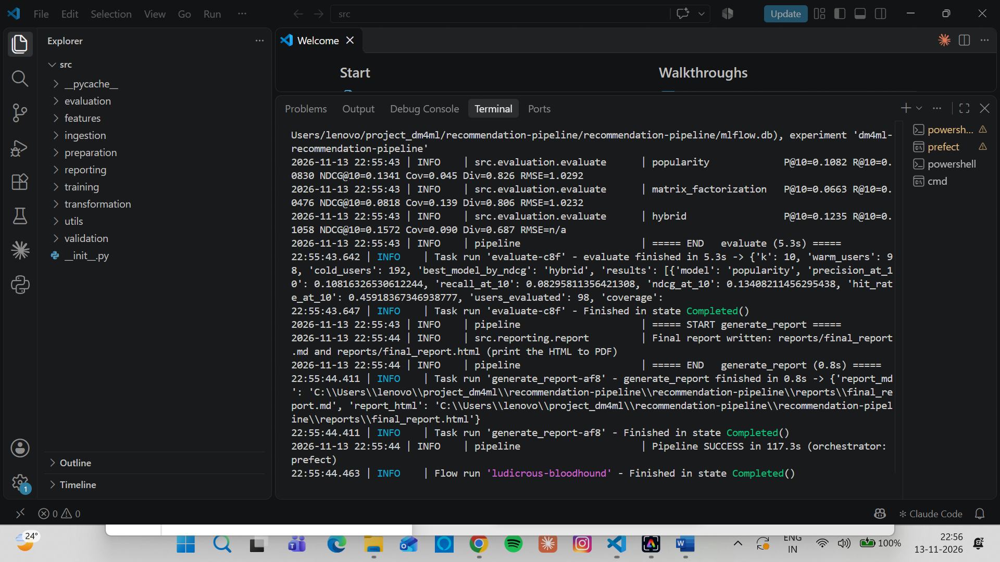
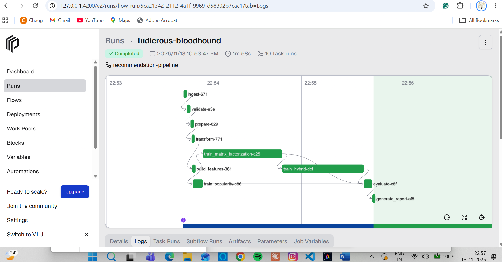
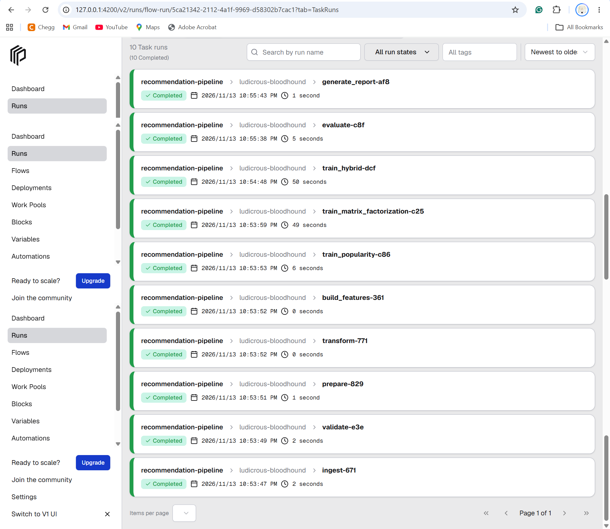
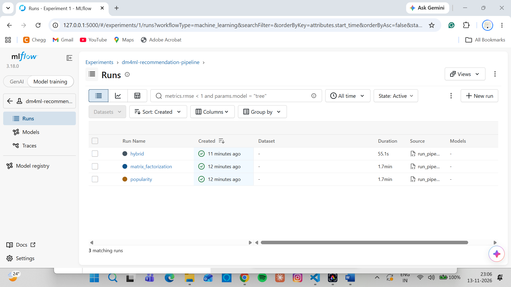
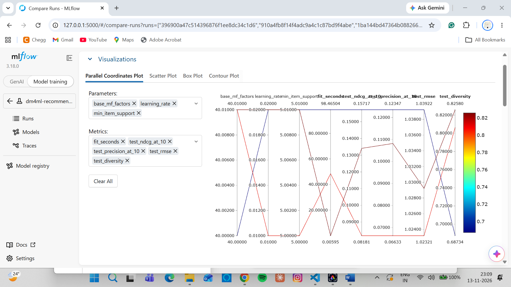
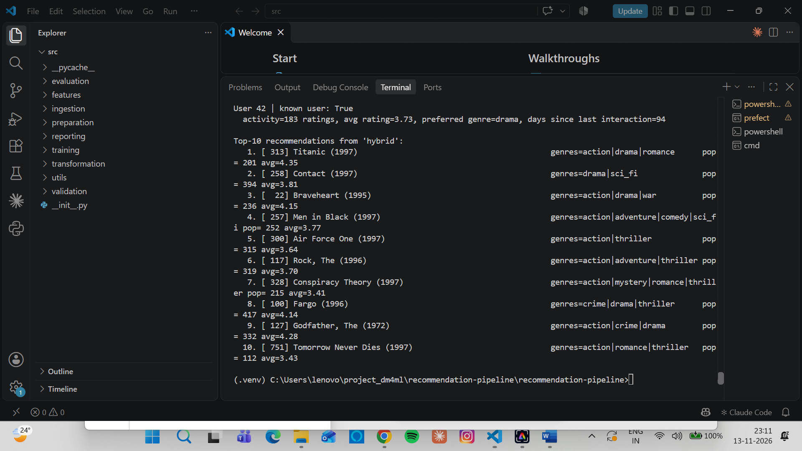

# Run Evidence - Successful End-to-End Execution

Pipeline executed on **2026-11-13** (Windows, VS Code, Python 3.12 virtual environment) on the **MovieLens 100K** dataset,
orchestrated by **Prefect 3.9** with experiment tracking in **MLflow 3.18**.

## 1. Pipeline run - terminal output
`python run_pipeline.py` finished with **`Pipeline SUCCESS in 117.3s (orchestrator: prefect)`** and Prefect flow run
`ludicrous-bloodhound` *Finished in state Completed*. The evaluation step logs the test metrics of each model.

## 2. Prefect flow run - DAG / timeline (orchestration deliverable)
Flow `recommendation-pipeline`, run `ludicrous-bloodhound`: **Completed, 10 task runs, 1m 58s**. The graph shows the task
dependencies: ingest -> validate -> prepare -> transform -> build_features -> train_popularity / train_matrix_factorization ->
train_hybrid -> evaluate -> generate_report.

## 3. Prefect task runs - all 10 completed

## 4. MLflow experiment - one tracked run per model
Experiment `dm4ml-recommendation-pipeline` contains the runs **popularity**, **matrix_factorization** and **hybrid**
(parameters, training metrics, test metrics, lineage tags and the pickled model as an artifact).

## 5. MLflow run comparison - parameters vs test metrics

## 6. Prediction using the shared feature store
`python recommend.py --user 42` loads the trained hybrid model and the same `FeatureStore` used in training, prints the
user's features (183 ratings, average 3.73, preferred genre *drama*) and the top-10 recommendations.

## Test-set results (K = 10, from the run above)
| Model | Precision@10 | Recall@10 | NDCG@10 | Coverage | Diversity | RMSE |
|---|---:|---:|---:|---:|---:|---:|
| Popularity (baseline) | 0.1082 | 0.0830 | 0.1341 | 0.045 | 0.826 | 1.0292 |
| Matrix Factorization | 0.0663 | 0.0476 | 0.0818 | 0.139 | 0.806 | 1.0232 |
| **Hybrid (MF + content + popularity)** | **0.1235** | **0.1058** | **0.1572** | 0.090 | 0.687 | n/a |

Full table: `reports/model_comparison.md`.
